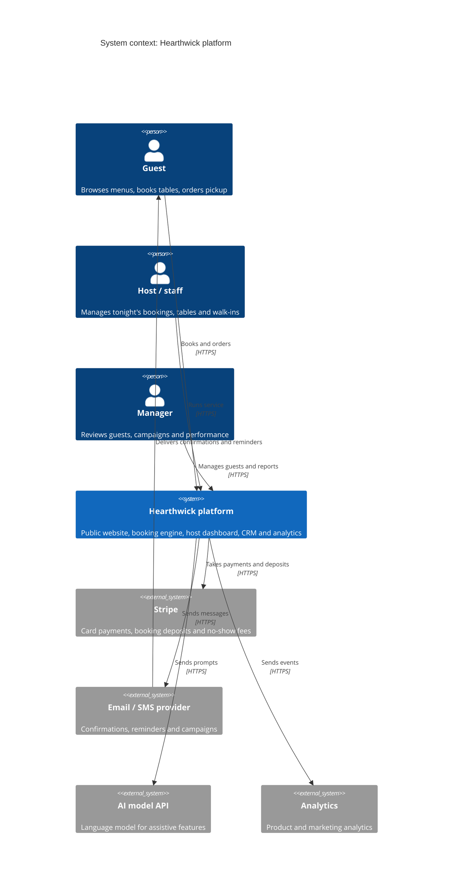
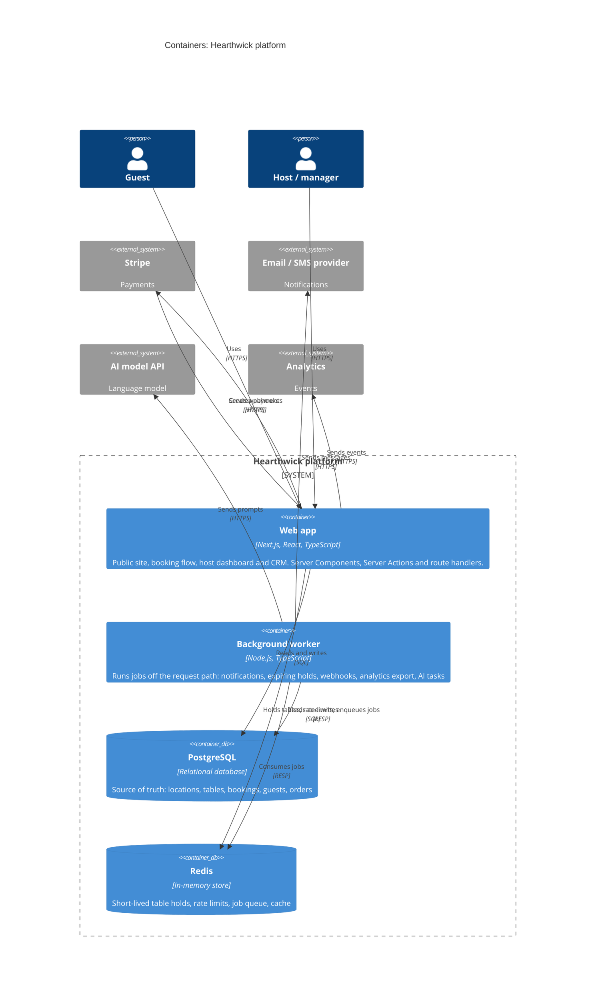

# Hearthwick architecture (C4)

This is the **target** architecture for the Hearthwick platform, described with the [C4 model](https://c4model.com). Today only the web app exists, and booking availability comes from typed mock data (`lib/mock/`). The diagrams show where the project is heading, so each new feature has a clear home.

GitHub renders these Mermaid diagrams directly.

## Level 1: System context

Who uses the platform, and which outside systems it depends on.

## Level 2: Containers

The deployable pieces inside the platform and how they talk to each other.

## Key decisions

**Booking under load: holds in Redis, truth in PostgreSQL.** When a guest picks a time, the web app places a hold with a 10-minute expiry in Redis, so other guests see the slot as taken while the first one finishes. The confirmed booking is written to PostgreSQL in a transaction, and a database constraint rejects overlapping bookings for the same table. Redis keeps the common case fast; the database guarantees no double-booking even if two requests race.

**Slow or unreliable work runs in the worker.** Sending email and SMS, calling the AI model, and exporting analytics can be slow or fail. The web app enqueues a job and responds straight away; the worker retries failed jobs without making a guest wait.

**Stripe webhooks are the source of payment state.** A payment is only treated as complete when Stripe's signed webhook confirms it, not when the browser says so.

**Availability behind an interface.** The UI reads availability through a typed interface. Today a mock implements it (`lib/mock/`); later the real service implements the same interface, so the UI does not change.

**External services are replaceable.** Messaging, AI and analytics sit behind small adapters, so a provider can change without touching booking logic. Personal data sent to them is limited to what each feature needs.
